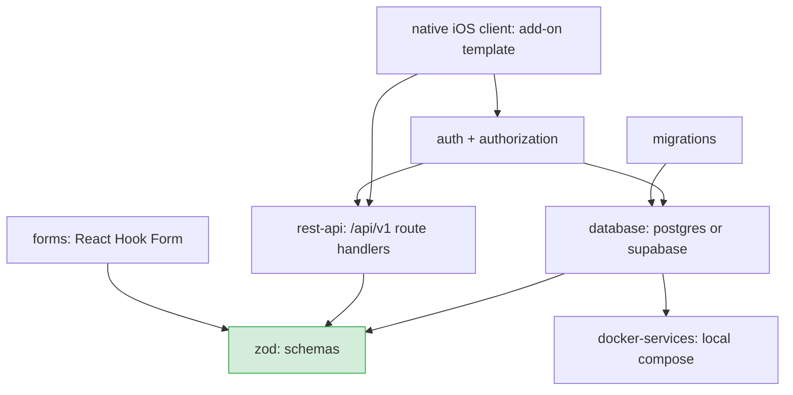

# Full-stack roadmap

A plan, not an implementation: only `zod` exists. It uses the mechanism in
`feature-composition.md` for every feature that can live in `web-core-template`. Nothing here adds
a database, authentication, endpoints, Docker services or cloud resources yet.

## Dependency relationships

| Feature | Requires | Adds npm dependencies | Adds services or tools | Independent of the database? |
| ------- | -------- | --------------------- | ---------------------- | ---------------------------- |
| `zod` (done) | none | `zod` | none | yes |
| `forms` | `zod` | React Hook Form, its Zod resolver; dev: DOM test libraries | none | yes |
| `rest-api` | `zod` | none (Next.js route handlers) | none | yes |
| `docker-services` | none | none (shares the base lock) | Docker Compose file | yes |
| `database` | `docker-services`, `zod` | a PostgreSQL client (Supabase client for that provider) | Postgres container; Supabase CLI for that provider | no |
| `migrations` | `database` | a migration runner (none if the provider's CLI is used) | CI Postgres service | no |
| `auth` | `database`, `rest-api`, `zod` | the auth library or Supabase auth client | none | no |
| native iOS | `rest-api`, `auth` (token based) | none (separate template) | Xcode, macOS CI | no |

**Independent today:** `zod`, `docker-services`. **Independent once `zod` exists:** `forms`,
`rest-api`. **A chain:** `docker-services` -> `database` -> `migrations` and `auth`. Rules the
registry will carry: `database=supabase` provides auth, so `auth=supabase-auth` requires
`database=supabase`; `deployment=vercel` conflicts with `database=postgres` (a local Postgres is
unreachable from Vercel). Deployment configuration is deliberately last.

## Sequence

Each increment ships as its own template release (see `release-strategy.md`), passes the full gate
for every configuration, and keeps the default output unchanged.

| # | Increment | Why here | Exit criteria |
| - | --------- | -------- | ------------- |
| 1 | `zod` (done) | Everything after it validates through its schemas. | This milestone. |
| 2 | `devkit upgrade` and offline contract snapshots (platform) | **Done** in devkit 0.3.0: range enforcement for existing projects before any breaking release, and CI-checkable compatibility before the option list grows. | `release-strategy.md`. |
| 3 | `forms` | Smallest next feature; client-only; exercises the `requires` rule and a feature with dev dependencies. | Tested form with shared-schema validation; first real rule enforced by a validator. |
| 4 | `rest-api` v1 | Defines the server boundary the database, auth and iOS all use. | Versioned handlers, problem-details errors, handler tests without a server. |
| 5 | `docker-services` + `database=postgres` + `migrations` | Local data layer behind the boundary. | Compose file, data-access layer, migrations tested against an ephemeral Postgres in CI. |
| 6 | `database=supabase` | A provider variant, not a new architecture. | Same data-access interface; local stack documented. |
| 7 | `auth` and authorization | Needs the data layer and the API. | Deny-by-default tests for every route; sessions covered by integration tests. |
| 8 | Native iOS add-on template | Needs a stable API and token auth. | Separate template with its own versions; client generated from the API contract. |

## Client and server trust boundaries

- **The server is the only trusted side.** Browser input, route parameters, headers, request bodies
  and Server Action arguments are untrusted. Each boundary parses with a shared Zod schema
  (`safeParse`) before use; client-side validation is only for experience and is never relied on.
- **Server-only code lives in `src/server/`** (data access, auth, anything holding a secret) and
  starts with `import "server-only"`. A generated test fails the build if a client component, or any
  module a client component imports, reaches `src/server/`.
- **Schemas are shared and secret-free.** `src/lib/schemas` may be imported by client and server; it
  contains shapes and rules, never keys, never connection details.
- **Authorization is enforced on the server, next to the data**, deny by default, through one
  central check in the data-access layer, never only in the UI or in middleware. With Supabase,
  row-level security is a second layer, not a replacement.
- **Return only what the caller needs.** Responses are built from explicit output schemas, not from
  raw database rows.

## Secrets handling

- Configuration comes from environment variables. The template ships a committed `.env.example`
  containing names and fake placeholders only, and `.env*` stays ignored.
- No secret in `NEXT_PUBLIC_*`, in client bundles, in logs or in error messages. The Supabase
  service-role key and database URLs are server-only. A generated test scans the project, and the
  built client output, for secret-shaped strings.
- Docker Compose reads `.env`; credentials for local services are throwaway and generated by the
  developer, never defaulted to something guessable in committed files.
- CI secrets are repository secrets, scoped to the job that needs them; the generated workflow keeps
  read-only permissions and gains no secrets by default.
- The platform never handles credentials (`devkit` runs git without prompts and redacts URLs).

## REST API and versioning

- Route handlers under `src/app/api/v1/...`; the version is part of the path. Within `v1`, changes
  are additive only (new optional fields, new endpoints). Anything breaking creates `v2` beside `v1`.
  Native clients cannot be force-updated, so an old version is retired only after a published
  deprecation window.
- Request and response bodies are Zod schemas in `src/lib/schemas/v1/`. Errors use one format
  (problem-details, RFC 9457) with stable machine-readable codes and no internals.
- The same schemas can emit JSON Schema or OpenAPI; that contract file is what the iOS template
  generates its client from, and what contract tests compare against.

## Database, migrations and local services

- PostgreSQL is the target; Supabase is a hosting provider for it, not a different data model.
- Migrations are plain SQL files, versioned in the repository and applied in order; the runner is
  chosen at that increment (SQL-first, no ORM lock-in, exact-pinned, runnable in CI). Supabase
  projects use the provider's migration directory.
- Local services run in Docker Compose with pinned image digests where practical, named volumes,
  and ports bound to localhost only.
- Tests run against a real Postgres (a CI service container), never a mock of the database.

## Native iOS

A separate add-on template with its own repository and versions, applied to the same project
directory with its own answers file. It contains the Xcode project and a client generated from the
API contract. Auth is token based, tokens live in the Keychain, and the app holds no server secrets.
It is the first likely use of template layering, so layering gets a prototype before that increment.

## Automated testing, per layer

| Layer | Test | Where it runs |
| ----- | ---- | ------------- |
| Schemas | Accept and reject tables, as `zod` ships today | `npm run check` |
| Forms | Component tests with a DOM environment | `npm run check` |
| Route handlers | Call the handler with a `Request`, assert the `Response` (status, body, headers); no server | `npm run check` |
| Authorization | For every route: unauthenticated -> 401, wrong role -> 403, owner -> 200 | `npm run check` plus integration |
| Data layer | Against an ephemeral Postgres | CI service container |
| Migrations | Apply to an empty database; compare the resulting schema to a committed snapshot | CI service container |
| Boundaries | Client code cannot import `src/server`; no secret-shaped strings in source or build | `npm run check` |
| Template matrix | Every valid configuration renders, locks match, installs, builds | template repository CI |
| Upgrades | A project survives a release with its features and edits | template repository CI |

## Risks to watch

- **The lockfile matrix** grows with each npm-affecting feature (cap and fallback in
  `feature-composition.md`). `database` and `auth` bring the largest dependency trees.
- **Shared files** (`layout`, config, `README`, `AGENTS.md`) collect guarded blocks; extract an
  extension point before a feature needs more than a few lines there.
- **`copier update` conflicts** concentrate in `package.json` and the lockfile; every release note
  must say whether dependencies changed.
- **Provider lock-in** if `database` code leaks Supabase specifics past the data-access interface.
